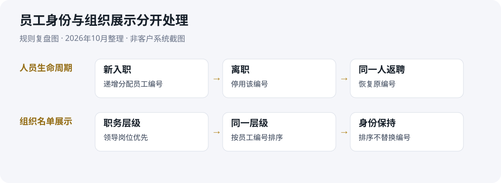

# 李梓裔 · AI解决方案与企业应用需求分析

深圳｜解决方案顾问 · 需求分析 · 应用交付

我擅长发现客户没有说清楚的业务条件，协同客户与研发把它们转为流程、原型和验收要求。我的经历覆盖企业SaaS、政企数字化和人力资源咨询；也在个人业务中使用AI工具辅助建设商机采集与客户管理应用。

## 两个核心案例

| 案例 | 业务问题与我的贡献 | 阅读入口 |
| --- | --- | --- |
| 国企人力资源管理系统 | 澄清员工身份、入离职和组织排序规则；协调研发、测试与验收。系统在客户本地部署并采用 | [完整案例](cases/hr-system/README.md) · [规则表](cases/hr-system/business-rules.md) · [验收场景](cases/hr-system/acceptance-scenarios.md) |
| 商机采集与CRM | 从实际拓客需求出发，个人主导需求、原型、AI辅助实现、测试和使用反馈；保留线索来源及跟进历史 | [完整案例](cases/leads-crm/README.md) · [业务流程](cases/leads-crm/workflow.md) · [验证边界](cases/leads-crm/verification.md) |

*上图是根据实际项目规则新整理的复盘图，不是客户系统截图。*

## 从哪里开始看

- 招聘方快速了解：[一页经历介绍](resume.md)
- 需求分析岗位：先看[人力资源规则表](cases/hr-system/business-rules.md)，再看[需求与验收对应表](cases/hr-system/traceability.md)
- 解决方案岗位：先看[CRM案例](cases/leads-crm/README.md)，再看[五分钟演示提纲](cases/leads-crm/demo.md)
- 查看项目分工与材料状态：[能力与证据](evidence/README.md)

## 我的工作方式

1. 从业务人员的实际操作出发，识别需求中的遗漏、冲突和异常情况。
2. 用原型、流程和规则说明对齐客户与研发，确认本次实施范围。
3. 参与测试与验收，跟踪问题和使用反馈，形成后续改进任务。

## 项目分工与技术实践

企业人力资源项目中，我负责项目管理、需求澄清、测试及验收协同，PHP全栈同事承担代码实现。个人CRM由我主导，Codex、DSH等AI工具辅助代码实现、调试、数据处理和部署。

我能独立完成方案演示、模型调用与工作流搭建；RAG检索、来源核对与效果测试可借助AI完成并解释。Python、API、SQL、日志分析和部署排障目前仍依赖AI辅助。

## 材料说明

这里展示脱敏案例和事后复盘，不公开客户原始文件、员工信息、客户数据库、账号或服务地址。新整理的规则与验收场景用于解释项目，不替代当年执行记录。当前未包含系统录屏或原始签署验收件；部分历史测试仅适用于隔离开发环境。

联系：liziyi1013@gmail.com
