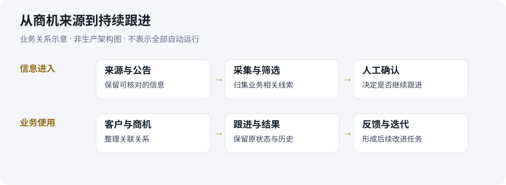

# 案例02 商机采集与客户管理

从真实拓客需求出发，个人主导业务流程与AI辅助应用实现。

| 项目 | 说明 |
| --- | --- |
| 时间 | 2026年6月至今 |
| 我的职责 | 需求发掘、方案与原型、AI辅助实现、测试、上线与持续优化 |
| 实现方式 | 无另聘技术同事；Codex、DSH等AI工具辅助代码、调试与部署 |
| 使用场景 | 本人的招投标线索整理、客户信息归集和业务跟进 |
| 使用结果 | 网页CRM用于实际业务，取得一笔咨询项目签单；不是软件销售成交 |

## 业务问题

招投标商机、客户信息和跟进记录需要持续整理。单条线索不仅要知道“是哪家公司”，还需要知道信息来自哪里、是否值得继续跟进、以前做过什么，以及后续操作是否保留原有记录。

我的目标是把采集、筛选、客户管理和跟进放在可持续使用的流程中，而不是只生成一次商机清单。

## 我亲自承担的工作

我从业务需求出发拆解流程，确定原型、字段和使用规则，使用AI编程工具辅助实现网页CRM。系统投入本人使用后，继续整理反馈、检查功能并安排迭代。

其中一个明确规则是：客户进入公海后，保留原跟进状态及历史，后续能够查看。该规则不应被描述为我修复过“覆盖历史记录”的故障，因为没有这样的已确认故障事实。

*本图是业务关系示意，不是生产系统架构或自动运行承诺。*

## 从日常使用到后续开发

日常采集与CRM已用于实际业务。后续CRM/SalesOS开发另外保留需求、测试和隔离浏览器验收材料。本轮查看的手动商机资料编辑日志明确标注隔离测试，不能据此称全部能力生产上线。

仓库当前记录云端独立服务运行，但真实网页登录与业务读回仍有待验收项。本作品集不提供公网演示地址，不将该状态写成客户已验收部署。

- [业务流程与规则](workflow.md)
- [验证记录的适用范围](verification.md)
- [五分钟演示提纲](demo.md)

## 结果与归因

工具已用于本人业务跟进，并取得一笔咨询项目签单。咨询成交仍包含客户沟通、方案和商务工作，不能全部归因于CRM。成交金额与周期本次不列；客户不是购买这套软件。

## 能力边界

需求分析、方案说明和完整演示由我承担。Python、API、SQL、日志与部署排障目前依赖AI辅助。模型调用与工作流搭建可独立完成，RAG实践可借助AI完成并解释；尚未在本案例公开完整效果评估记录。

[返回作品集首页](../../README.md)
