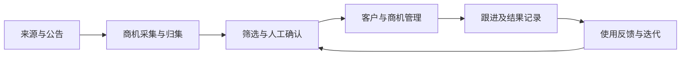

# 商机到跟进记录的业务流程

以下内容是对项目的事后复盘，不是数据库字段定义或冻结状态机。

## 关键业务规则

| 规则 | 业务目的 | 目前的材料基础 |
| --- | --- | --- |
| 保留信息来源 | 便于核对商机内容和判断 | 项目需求与后续开发资料；真实演示待核验 |
| 人工确认 | 在正式业务动作前判断线索是否可用 | 后续项目边界与本人使用方式 |
| 公海保留跟进状态及历史 | 重新查看时仍知道原来的跟进情况 | 本人明确确认；真实系统演示待补 |
| 重复操作检查 | 避免重复归集和重复记录 | 测试代码有相关检查；本轮未重跑 |
| 资料与阶段分开 | 修改业务资料不自动改商机阶段 | 后续手动编辑切片历史验收，隔离环境 |

## 不能混为一谈的对象

公司、项目商机和跟进记录承担不同用途。公司可能对应多个商机，一条商机可能包含多次跟进。以上是业务说明；本轮没有审计当前数据库完整结构，不能当作实际ER图。

## 一个规则复盘

客户进入公海是一种管理变化，不意味着此前跟进作废。演示时应同时检查当前所在客户池和过去记录是否可见，而不是只显示一个“释放成功”的提示。

[返回案例](README.md)
